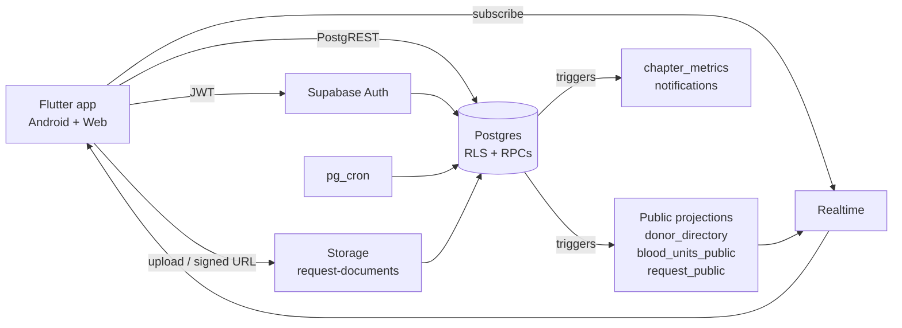
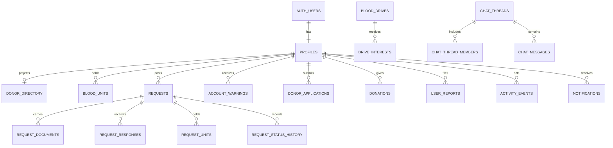
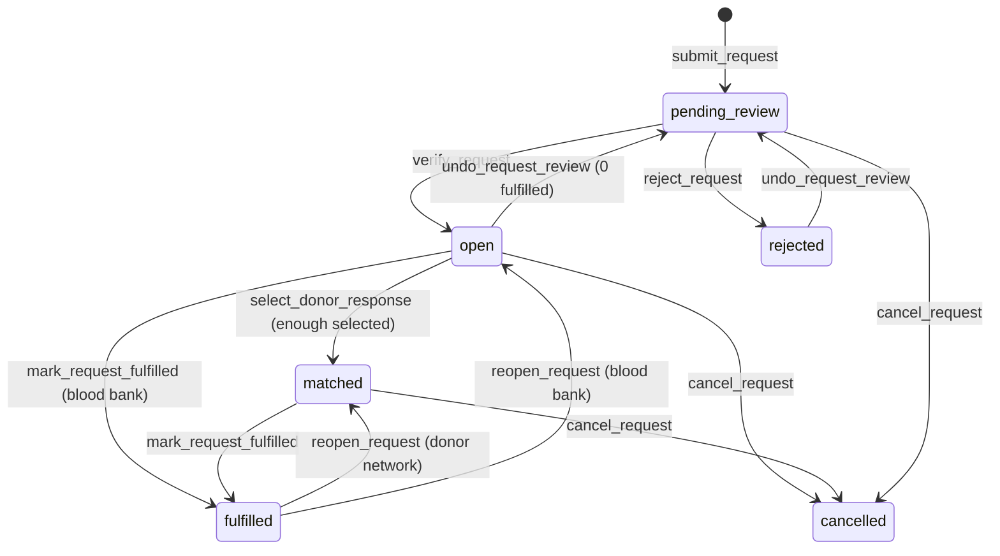
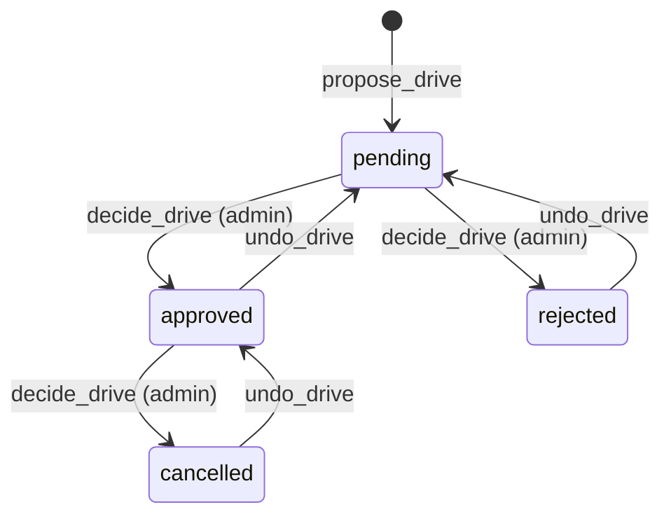

# TABANG — Backend & Sync Guide

**Status:** pre-Supabase migration blueprint  
**Baseline:** TABANG 2.0.0 base app, commit `c54125c`  
**Audience:** the developer who will replace the in-memory `TabangRepository` with Supabase

This guide is the narrative companion to:

- [`TABANG_Backend_Guide.xlsx`](TABANG_Backend_Guide.xlsx) — the full workbook: tables, columns, enums, relationships, RLS, realtime, storage, workflows, RPCs, sync rules, migration map and checklists.
- [`supabase_schema.sql`](supabase_schema.sql) — starter DDL, helper functions, policies, projection triggers and RPC stubs.

Use the workbook while implementing; use this page to understand the shape of the system.

---

## 1. The one-paragraph version

TABANG moves from a single in-memory store to **Supabase Auth + Postgres + Realtime + Storage**. `auth.users` owns credentials; `profiles` owns the application identity and role. All screens read the same Postgres rows, all multi-row workflows run inside **Postgres RPCs** in one transaction, and every screen subscribes only to the rows it displays. Public surfaces read **safe projection tables** (`donor_directory`, `blood_units_public`, `request_public`) so Realtime cannot leak phone numbers, emails, requester ids or staff notes.

---

## 2. Architecture



### What stays on the client

- UI, navigation, local cache, optimistic updates.
- Eligibility display can be computed locally for instant feedback, but **the server re-checks it on every write**.
- Static map geometry and bundled artwork stay in Flutter assets.
- No service-role key, no database password, no admin API key.

### What moves to the server

- Credentials and sessions.
- Role and account-status authority.
- Request lifecycle and inventory holds.
- Chat membership, blocks and read markers.
- Readiness counts and tab activity.
- File validation and signed URLs.

---

## 3. Entity model

The current Dart models are the source for names and behaviour. The backend keeps their intent but normalizes the arrays and embedded lists.



### Table groups

| Group | Tables |
|---|---|
| Identity | `profiles`, `profile_tab_seen`, `notifications` |
| Public projections | `donor_directory`, `blood_units_public`, `request_public` |
| Donors | `donations`, `donor_applications`, `account_warnings` |
| Inventory | `blood_units`, `inventory_removals` |
| Requests | `requests`, `request_documents`, `request_units`, `request_responses`, `request_status_history` |
| Drives & content | `blood_drives`, `drive_interests`, `content_items` |
| Messaging | `chat_threads`, `chat_thread_members`, `chat_messages`, `user_blocks`, `user_reports` |
| Operations | `activity_events`, `readiness_targets`, `chapter_metrics`, `moderation_keywords` |
| Reference/config | `barangays`, `facilities`, `blood_types`, `blood_components`, `document_requirements`, `donor_requirements`, `donor_screening_questions`, `chapter_settings`, `role_capabilities`, `tab_activity_rules` |

Full column dictionary: **Columns** sheet in the workbook.

### Completeness audit

The workbook now includes a **Coverage Audit** sheet with **282 rows**: every Dart class, enum, field, derived getter, constant list, repository state field and auth artifact is mapped to a table column, a normalized row, a derived view/function, a config table, or explicitly marked client-only/ephemeral. The **Gap Closure** sheet records the differences found during that audit and where each is fixed.

The first draft was not complete enough. The audit found and closed these gaps:

- Missing `barangays` and `facilities` reference data.
- Missing blood type/component labels, shelf life and cooldown configuration.
- Missing document requirements, donor requirements and screening questions.
- Missing chapter identity, staff room, warning reason, blood-bank hours and eligibility constants.
- Missing role-capability and tab-dot rule tables.
- Missing `EligibilityBlocker`, `daysRemaining` and donor-type mapping in the donor projection.
- Missing alias snapshots on warnings, reports, activity, thread members and responses.
- Missing `legacy_id` on responses, warnings, applications, removals, content, threads, messages, reports and activity.
- Missing `previewAsset` for seeded request documents.
- No way to represent the chapter organization account because `profiles.id` requires `auth.users`.
- No direct-thread pair uniqueness/cardinality rule.
- No donation rows or trigger to maintain cached totals/last donation.
- No backend home for unread counts, last message, flagged counts, per-type/barangay stats or shortage lists.

Every one of those is now in the workbook, the SQL starter, or both, and each is called out in **Gap Closure**.

---

## 4. Design decisions that matter

### 4.1 One auth record, one profile

- `auth.users.id` is the application user id.
- A trigger creates `profiles` after signup.
- `profiles.role` is the only role authority.
- Self-registration always creates `role = 'user'`.
- Staff/admin accounts are provisioned outside the app.
- Staff-created walk-ins use an Edge Function or Admin API call with the service key **on the server only**, and return a temporary password once.

### 4.2 Public projections, not broad base-table access

RLS controls rows, not columns. A Realtime payload contains the row that changed. If a community screen subscribes to `requests`, a donor could receive `requester_id`, `review_note` and other private fields in the payload.

Use physical projection tables:

- `donor_directory` — public donor card fields, no email/phone/full name.
- `blood_units_public` — stock without `reserved_by` or `reservation_note`.
- `request_public` — board/map fields without `requester_id`, `note` or `review_note`.

They are maintained by triggers and refreshed by a scheduled job. Community screens subscribe to these, not the base tables. Staff screens use the base tables under staff RLS.

### 4.3 Normalize embedded lists

| Current model | Backend |
|---|---|
| `BloodRequest.assignedUnitIds` | `request_units` rows |
| `ChatThread.memberIds` | `chat_thread_members` rows |
| `ChatThread.memberReadAt` / participant read fields | `chat_thread_members.last_read_at` |
| `BloodRequest.documents` | `request_documents` + Storage |
| `AppUser.allowedComponents` | `blood_component[]` (or a join table if you need per-component history) |
| `totalDonations` / `lastDonationDate` | `donations` rows + cached profile values |

### 4.4 Keep legacy ids only for the demo

Use UUID primary keys. Keep `legacy_id` (`USR-001`, `REQ-003`, `DRV-001`) for migration, screenshots and the demo. Never generate ids from `length + 1`; that races under concurrent writes.

### 4.5 Server time and timezone

Store every event, message, hold and request timestamp as `timestamptz` in UTC. Display in `Asia/Manila`. The current app uses local `DateTime`; the backend must not inherit that ambiguity.

### 4.6 Counts and readiness are computed

`chapter_metrics` is a derived singleton row refreshed by triggers or a short `pg_cron` job. Do not recompute the readiness score by scanning every table in the Flutter client. The score is still never entered by hand.

### 4.7 Derived and pre-calculated values

Several values are deliberately not columns. They are computed in one place and consumed everywhere:

| Value | Backend home |
|---|---|
| Unit effective status / expiry | `blood_units_public.effective_status`, `expires_on` |
| Donor eligibility, blocker, days remaining | `donor_directory` projection + eligibility function/job |
| Public request fields | `request_public` |
| Public stock fields | `blood_units_public` |
| Chapter KPIs and readiness score | `chapter_metrics` |
| Donations vs requests per blood type | `blood_type_stats` view |
| Donations/donors per barangay | `barangay_stats` view |
| Eligible donors/open requests/pending applications by barangay | `donor_counts_by_barangay`, `open_requests_by_barangay`, `pending_applications_by_barangay` |
| Unread messages, last message, flagged count | `thread_unread_counts`, `thread_last_message`, `thread_moderation_summary` |
| Expiring units, critical shortage types | `expiring_soon`, `critical_shortage_types` |
| Request can-be-fulfilled/rejected/accepts responses | SQL expression/RPC guard |
| Role capabilities | `role_capabilities` |
| Tab-dot rules | `tab_activity_rules` |
| Age, initials, map handle, unit time-left, size label | UI/date math; `public_handle` for the map handle |

The **Derived & Precomputed** sheet lists **83** of these with their exact formula or backend home. If a value is not in that sheet, it is either stored in the **Columns** sheet or explicitly marked client-only in **Coverage Audit**.

### 4.8 IDs and cardinalities

- Use UUID primary keys. Keep `legacy_id` for `USR-###`, `REQ-###`, `RES-###`, `WRN-###`, `ROOM-###`, `DRV-###`, `RPT-###`, `ACT-...`, `MSG-...` and `DNA-###`.
- `blood_units.barcode` is the natural key.
- `USR-CHAPTER` is a real auth user with `profiles.is_system = true`, a random unshared password and interactive login disabled. It is the organization identity, not a staff login.
- `STAFF-ROOM` is a `chat_threads.legacy_id`.
- One direct thread per pair: `chat_threads.pair_key` unique.
- One response per `(request_id, donor_id)`.
- One document per `(request_id, kind)`.
- One active hold per barcode: partial unique index on `request_units`.
- One active block per `(blocker_id, blocked_id)`.
- One open donor application per user.
- One donor, one active commitment: enforced in `select_donor_response`, not by a simple unique index.
- Direct threads have exactly two members; group threads have at least two and a name; chapter threads are the chapter account plus one user. Enforce these in the thread RPC/trigger.

### 4.9 Audit first, delete later

- Requests have `request_status_history`.
- Inventory removals keep a JSON snapshot.
- Warnings are revoked, not deleted.
- Messages are soft-deleted.
- `activity_events` answers “who changed what”.

---

## 5. Row-level security

Enable RLS on **every** table in `public`. Deny by default.

Helper functions:

```sql
create or replace function public.is_staff()
returns boolean
language sql stable security definer
set search_path = public
as $$
  select exists (
    select 1 from profiles
    where id = auth.uid()
      and role in ('staff', 'admin')
      and status <> 'suspended'
  );
$$;

create or replace function public.is_admin()
returns boolean
language sql stable security definer
set search_path = public
as $$
  select exists (
    select 1 from profiles
    where id = auth.uid()
      and role = 'admin'
      and status <> 'suspended'
  );
$$;
```

### Row scopes

| Table | Community user / donor | Staff / admin |
|---|---|---|
| `profiles` | own row only; update safe fields | all rows; operational updates |
| `donor_directory` | read all | read all |
| `blood_units` | own holds only | all |
| `blood_units_public` | read all | read all |
| `requests` | own rows, insert, cancel own | all; lifecycle via RPC |
| `request_public` | read all | read all |
| `request_documents` | own request; upload own | all |
| `request_responses` | own offer; requester sees responses to own request | all |
| `account_warnings` | own; acknowledge | all; issue/revoke |
| `donor_applications` | own; submit | all; decide |
| `donations` | own | all; record |
| `blood_drives` | approved only | all; propose |
| `drive_interests` | own | all |
| `content_items` | published | all; write |
| `chat_threads` / `chat_messages` | member threads | moderation access |
| `user_blocks` | own blocker rows | all |
| `user_reports` | own reports | all; resolve |
| `activity_events` | own actor/subject events | all |
| `readiness_targets` | read | read; admin writes |
| `chapter_metrics` | none | read |
| `notifications` | own | own |

Detailed matrix: **RLS Matrix** sheet.

### Policy pattern

```sql
alter table public.requests enable row level security;

create policy requests_select_own
on public.requests for select
using (requester_id = auth.uid());

create policy requests_select_staff
on public.requests for select
using (public.is_staff());

create policy requests_insert_own
on public.requests for insert
with check (requester_id = auth.uid());
```

Never let the client update `role`, `status`, `total_donations`, `blood_card_verified` or `warning_count` directly. Those go through RPCs.

---

## 6. Realtime

Realtime is a **change notification**, not the initial load. On app start, reconnect or resume, query the visible window first, then subscribe.

### Publication

```sql
alter publication supabase_realtime add table
  public.profiles,
  public.donor_directory,
  public.blood_units,
  public.blood_units_public,
  public.requests,
  public.request_public,
  public.request_documents,
  public.request_responses,
  public.request_units,
  public.blood_drives,
  public.drive_interests,
  public.chat_threads,
  public.chat_thread_members,
  public.chat_messages,
  public.user_blocks,
  public.user_reports,
  public.account_warnings,
  public.donor_applications,
  public.activity_events,
  public.readiness_targets,
  public.chapter_metrics,
  public.notifications,
  public.content_items;

alter table public.requests replica identity full;
alter table public.chat_messages replica identity full;
```

### Subscription rules

1. Subscribe per screen, not one global channel.
2. Filter by the smallest key available: `thread_id`, `request_id`, `user_id`, `drive_id`.
3. Always re-query on `reconnect`, app resume and tab focus.
4. Merge by primary key; never append blindly.
5. Ignore stale read markers (`last_read_at` lower than cached value).
6. On `DELETE`, remove by key; on `UPDATE`, replace/merge the row.
7. Cap message subscriptions to the open thread plus the user's thread list.
8. Do not subscribe community screens to base tables with PII.

### Screen summary

| Screen | Subscribe to |
|---|---|
| Home | `content_items`, `blood_drives` (approved), `notifications` |
| Blood Bank | `blood_units_public`, own `blood_units` holds |
| Find Donor | `donor_directory`, `blood_drives`, `request_public` |
| Requests | `request_public`, own `requests`, `request_responses` |
| Donor Hub | own `profiles`, `donor_applications`, `account_warnings`, `donations` |
| Messages | `chat_threads`, `chat_thread_members`, `chat_messages`, `user_blocks` |
| Overview | `chapter_metrics`, `readiness_targets`, `activity_events` |
| Operations | `requests`, `request_responses`, `donor_directory`, `blood_units_public`, `blood_drives` |
| Inventory | `blood_units`, `request_units`, `inventory_removals`, `request_documents` |
| Users | `profiles`, `donor_applications`, `account_warnings`, `activity_events` |
| Moderation | `user_reports`, `chat_messages`, `chat_threads`, `moderation_keywords` |

Full matrix: **Realtime** sheet.

---

## 7. Workflows and RPCs

Every multi-row change must be one Postgres function. The client sends intent; the server validates role, state and side effects together.

| Workflow | RPC | Critical checks |
|---|---|---|
| Submit request | `submit_request` | 3 required document rows; slot inside schedule; units 1–20 |
| Verify request | `verify_request` | staff; `pending_review`; all assigned units available and unheld; create holds |
| Reject request | `reject_request` | staff; reason; release holds; decline pending offers |
| Undo review | `undo_request_review` | rejected or open with 0 fulfilled; release holds |
| Donor response | `respond_to_request` | request accepts responses; donor eligible/compatible; no duplicate |
| Select donor | `select_donor_response` | requester only; reciprocal human chat; no other active commitment; enough selected → `matched` |
| Fulfil | `mark_request_fulfilled` | staff; correct source/state; insert `donations`; close |
| Reopen fulfilled | `reopen_request` | staff; only fulfilled |
| Cancel | `cancel_request` | requester/staff; not terminal; release holds/offers |
| Add/status unit | `add_blood_unit`, `set_unit_status` | staff; shelf life; never revive expired |
| Hold/release/remove/restore | `reserve_unit`, `release_unit`, `remove_unit`, `restore_unit` | no double hold; ledger snapshot; duplicate barcode guard |
| Donor application | `submit_donor_application`, `decide_donor_application` | age 18–65; weight; one open application; verified syncs blood-card flag |
| Drive lifecycle | `propose_drive`, `decide_drive`, `undo_drive` | staff propose; admin decide; expected state |
| Warnings | `warn_user`, `revoke_warning` | max 3; third suspends; revoke steps down |
| Account status | `set_account_status` | staff cannot manage peers unless admin; no admin creation |
| Block | `block_user`, `unblock_user` | not self; 48-hour re-block cooldown |
| Identity reveal | `request_identity_reveal`, `accept_identity_reveal`, `decline_identity_reveal` | two-sided consent |
| Reports | `submit_report`, `resolve_report` | reporter is participant; staff resolves |
| Messaging | `send_message`, `mark_thread_read` | member; not muted; not blocked; per-member read |
| Readiness | `set_readiness_targets` | admin only; positive values |
| Walk-in account | `create_walkin_user` | staff for community; admin for staff; never admin |

### Request state machine



### Drive state machine



The important rule: **a proposal can never approve itself**.

---

## 8. Storage

| Bucket | Path | Access |
|---|---|---|
| `request-documents` | `{user_id}/{request_id}/{kind}/{uuid}.{ext}` | private; owner uploads/reads, staff reads, staff deletes |
| `avatars` | `{user_id}/{uuid}.{ext}` | optional; public read, owner write |
| `content-images` | `content/{content_id}/{uuid}.{ext}` | optional; public read, staff write |
| `branding` | `branding/{file}` | optional; public read, admin write |

Rules:

- Max 8 MB per request document; PDF, JPG or PNG.
- Validate MIME and extension on the server, not only in the picker.
- Store only metadata in `request_documents`; store bytes in Storage.
- Generate signed URLs on demand (60–300 seconds). Never store signed URLs.
- Delete orphan storage objects with a scheduled job after the request/document row is removed.
- Do not expose the storage path publicly in community projections.

### Upload order

The current Dart dialog picks files before it creates the request. Supabase needs a request id before the storage path can be anchored. Pick one of these patterns:

1. **Client-generated id (recommended):** generate a UUID in Flutter, upload to `{user_id}/{request_uuid}/{kind}/{file}`, then call `submit_request(p_request_id => request_uuid, ...)`. The RPC inserts the request and its document rows in one transaction.
2. **Draft request:** insert a hidden `draft` request, upload, then promote it to `pending_review`. Add a `draft` status or a `created` boolean if you choose this route.

Do not insert the request first and hope the upload succeeds afterwards: a failed upload must not leave a submitted request without its three required documents.

---

## 9. Sync model

### Initial load

1. `supabase.auth.onAuthStateChange` gives the session.
2. Load the profile by `auth.uid()`.
3. Route by `profiles.role`.
4. Load the visible screen's rows.
5. Subscribe to that screen's tables.
6. Cache the snapshot locally.

### Writes

1. Optimistic local update only where the UI needs it (message send, interest toggle, read marker, warning acknowledgement).
2. Call the RPC.
3. Replace the optimistic row with the returned row.
4. Other screens receive the Realtime event and merge.
5. On error, roll back and refetch the affected row.

### Conflict handling

- Server wins for lifecycle, inventory and role.
- `updated_at` or `row_version` is the tiebreaker.
- Writes carry an optional `client_mutation_id` for idempotency.
- Duplicate-safe constraints:
  - `profiles.alias` unique (case-insensitive)
  - `blood_units.barcode` unique
  - one response per `(request_id, donor_id)`
  - one active `request_units` hold per barcode
  - one open donor application per user
  - one active block per `(blocker_id, blocked_id)`

### Reconnect

Always refetch the visible window after reconnect. Realtime can miss events while the socket is down or the app is backgrounded; it is not a durable queue.

### Offline

The base app is online-first. If offline support is required later, add a local queue with:

- `client_mutation_id` (UUID per queued write)
- operation type and payload
- attempt count and last error
- server-side idempotency check
- conflict UI only for editable profile/preferences, not clinical workflows

---

## 10. Migration from the Dart repository

| Current method | Backend |
|---|---|
| `AuthService.signIn` / `register` | `supabase.auth` + `create_profile` trigger |
| `AuthService.adminCreateUser` | `create_walkin_user` (server-side Admin API) |
| `repo.updateUser` | `update_own_profile` RPC (whitelisted fields) |
| `repo.markActive` | `touch_last_active` |
| `repo.recordDonation` | `record_donation` (insert `donations`) |
| `repo.addRequest` | `submit_request` |
| `repo.verifyRequest` | `verify_request` |
| `repo.rejectRequest` | `reject_request` |
| `repo.respondToRequest` | `respond_to_request` |
| `repo.selectResponse` | `select_donor_response` |
| `repo.markRequestFulfilled` | `mark_request_fulfilled` |
| `repo.reserveUnit` / `releaseUnit` | `reserve_unit` / `release_unit` |
| `repo.removeBloodUnit` / `restoreRemovedUnit` | `remove_unit` / `restore_unit` |
| `repo.warnUser` / `revokeWarning` | `warn_user` / `revoke_warning` |
| `repo.sendMessage` | `send_message` |
| `repo.markThreadRead` | `mark_thread_read` |
| `repo.summary` / stats | `chapter_metrics` + aggregate RPCs |

Full map: **Migration Map** sheet.

---

## 11. Demo seed

| Role | Email | Password |
|---|---|---|
| Donor | `juan.delacruz@tabang.app` | `donor1234` |
| Donor | `tere.santos@tabang.app` | `donor1234` |
| Donor (away) | `rafael.mendoza@tabang.app` | `donor1234` |
| Recipient | `maria.santos@tabang.app` | `recipient1234` |
| Community | `community@tabang.app` | `community1234` |
| Staff | `marco.villanueva@tabang.app` | `staff1234` |
| Admin | `admin@tabang.app` | `admin1234` |

Seed through the Supabase Auth Admin API, then insert `profiles` rows with the same `legacy_id` values. The chapter account (`USR-CHAPTER`) is an organization identity, not a login. Never seed production with these passwords.

Target demo parity: 15 eligible donors, 2 away donors, 15 recipients, the community account, staff/admin, the seeded units, requests, responses, drives and content items.

---

## 12. Build order

1. **Schema** — enums, tables, keys, indexes, constraints, `updated_at` triggers.
2. **Auth & profiles** — signup trigger, role guard, staff/admin seed.
3. **RLS** — helper functions, per-table policies, projection tables.
4. **Reads** — replace repository getters screen by screen.
5. **Writes/RPCs** — request lifecycle, inventory, drives, warnings, moderation.
6. **Storage** — upload, signed preview, cleanup.
7. **Realtime** — targeted subscriptions, reconnect refresh.
8. **Derived data** — projections, `chapter_metrics`, eligibility job, expiry job, notifications.
9. **Seed & QA** — 210-test parity, backend integration tests, two-device checks.
10. **Cutover** — backup, freeze writes, deploy web, rebuild APK, rollback plan.

Do not start with Realtime. A correct schema and transactional RPCs matter more than a live cursor.

---

## 13. Edge cases to test explicitly

- Two requesters select the same donor at the same time → only one active commitment.
- Two staff reserve the same bag at the same time → one wins, the other gets a clear retry message.
- A request is rejected while a donor response arrives → response is declined, not orphaned.
- A request is fulfilled twice → second call is a no-op.
- A fulfilled request is reopened → units fulfilled reset, donation history retained.
- A bag expires between page load and hold → server refuses with `unit_expired`.
- A donor enters cooldown between offer and selection → selection fails with a readable reason.
- A staff member is suspended → staff RPCs refuse immediately.
- An admin changes readiness targets → overview updates on other devices.
- A message arrives while the thread is open → unread count does not increment for the reader.
- A block is lifted → re-block is refused for 48 hours.
- A document is uploaded but the request insert fails → storage object is cleaned up.
- A user deletes/recreates a device → profile and read markers sync from the server.
- A public projection is stale → it is a cache, never the authorization source; staff actions use base tables.
- Two writes update the same profile → last-write-wins only for preferences; role/status use RPC guards.

---

## 14. What the Excel workbook contains

| Sheet | What it is for |
|---|---|
| Start Here | Purpose, golden rules, reading order |
| Architecture | Components and responsibilities |
| Table Catalog | Every table and why it exists |
| Columns | Full column dictionary with types, constraints and Dart mapping |
| Enums | DB values and mapping notes |
| Relationships | Foreign keys, cardinality, delete rules |
| RLS Matrix | Row scopes per role |
| Realtime | Event/filter/consumer matrix |
| Storage | Buckets, paths, MIME, size and policies |
| Workflows | Steps, actor, RPC, tables and rules |
| RPC Functions | Function catalog and checks |
| Triggers & Jobs | Server-side consistency and scheduled work |
| Sync Rules | Screen-by-screen load/subscribe/cache/conflict plan |
| Migration Map | Current Dart method → Supabase operation |
| Seed Data / Seed Counts | Demo accounts and parity targets |
| Security Checklist | Non-negotiables |
| Implementation Phases | Suggested build order |
| SQL Snippets | Copy/paste starters |
| Coverage Audit | Every Dart class, enum, field, getter, constant and repository state field mapped |
| Derived & Precomputed | Every computed getter/aggregate and its backend home |
| IDs & Constraints | ID formats, keys, uniqueness and cardinality |
| Gap Closure | Differences found in the completeness audit and where each is fixed |

The SQL file is a **starter**, not a tested migration. Review it against your Supabase project, then split it into versioned migrations (`supabase migration new ...`). Do not run it blindly on a project with data.